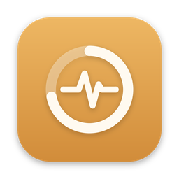
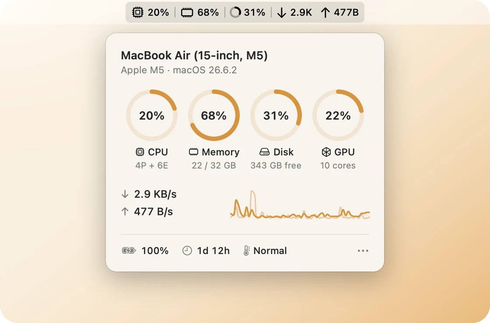

<h1 align="center">Vitals </h1>

<p align="center">
  A tiny macOS menu bar app that shows your Mac's CPU, memory, disk and network at a glance.
</p>

<p align="center">
  
  
  
</p>

<p align="center">
  <picture>
    <source media="(prefers-color-scheme: dark)" srcset="docs/hero-dark.webp">
    
  </picture>
</p>

## What it does

- **Lives in your menu bar.** CPU, memory, how full your disk is, and live download and upload speeds, in one row.
- **Opens to more.** Rings for CPU, memory, disk and GPU, a two-minute network graph, plus battery, uptime and temperature. Hover over a ring or the battery for detail.
- **Frees up space.** Click the Disk ring to clear app caches and Xcode build files, pick old downloads to move to the Bin, and empty the Bin. Each shows how much it frees first.
- **Made to stay on.** Checks every 2 seconds, lets macOS group its wake-ups to save power, and only redraws the panel while it's open.
- **Private.** Reads your Mac's own counters. Nothing leaves your Mac.

## Install

1. Download `Vitals.zip` from the [latest release](https://github.com/Sir-Monke/Vitals/releases/latest) and unzip it.
2. Open Vitals. The first time, macOS says it can't check the app: open **System Settings › Privacy & Security**, scroll down and choose **Open Anyway**.
3. Vitals moves itself into Applications, opens its panel and starts at login. Change that, or quit, from the **⋯** menu in the panel.

Can't see it? Open Vitals again: it opens its panel, or tells you if your menu bar is too full to show it.

The first time you free up space, macOS asks whether Vitals may see your Downloads folder and, to empty the Bin, control Finder.

## Build it yourself

Open `Vitals.xcodeproj` in Xcode and press Run. Vitals copies itself into Applications, opens from there and starts at login.

## Self-test

```sh
/Applications/Vitals.app/Contents/MacOS/Vitals --selftest
```

## Remove

Choose **⋯ › Quit Vitals**, then drag Vitals from Applications to the Bin.
